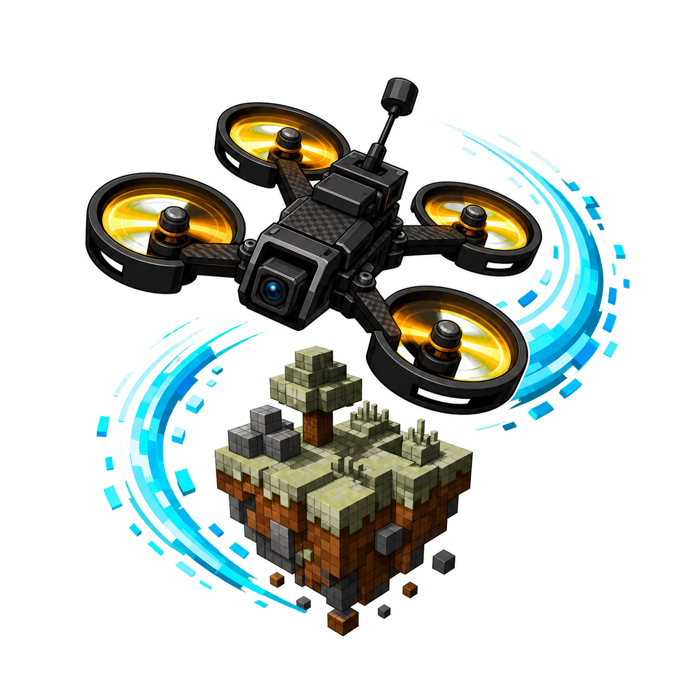

  

# FPV Dronecraft

Multirotor flight simulation for Minecraft, with FPV/line-of-sight flying, controller calibration, route-tested flight-model architecture, and an experimental high-fidelity simulation core.

Languages: [简体中文](#简体中文) | [繁體中文](#繁體中文) | [English](#english) | [日本語](#日本語)

Progress archive: [简体中文完整原始记录](docs/progress/progress.zh-CN.md) | [繁體中文整理版](docs/progress/progress.zh-TW.md) | [English summary](docs/progress/progress.en.md) | [日本語要約](docs/progress/progress.ja.md)

The published Git tag is [v0.1.1-playtest.11-fabric](https://github.com/SakalioLabs/FPV-Dronecraft/tree/v0.1.1-playtest.11-fabric) (Fabric). NeoForge is under development at `0.2.0-neoforge-dev.1`; the tag does not contain a NeoForge build.

## 简体中文

FPV Dronecraft 是一个面向 Minecraft NeoForge 的多轴无人机/穿越机模拟 Mod。项目目标不是把无人机做成普通载具，而是在 Minecraft 世界中实现可游玩的 FPV 飞行体验，同时保留可继续研究的飞行动力学、遥测、诊断和模型验证基础。

### 当前状态

- 默认构建目标：Minecraft `1.21.1`、NeoForge `21.1.257`
- Mod 版本：`0.2.0-neoforge-dev.1`
- 1.21.1 至 26.3 共 16 个配置已启用实际源码 overlay，全部仍处于适配中；启用不等于完整支持。
- 最终逐目标状态：16 个固定目标的 build/package、服务端四种飞行自测和客户端标题/模型/20 ticks smoke 均通过。15 个目标的完整记录在 `build/reports/neoforge-matrix/20261010-103859-388`；26.1 server 也在该报告通过，26.1 build/client 补跑记录在 `build/reports/neoforge-matrix/20261010-112848-528`。原 `103859-388` 总结果仍为失败，保留其修复前 26.1 client 失败记录；逐阶段最新来源见版本清单。
- Java：1.21.x 使用 `21`；26.x 使用 `25`
- 已发布的 Git tag `v0.1.1-playtest.11-fabric` 对应 Fabric 版本

### 功能概览

- 放置无人机物品即可生成未绑定无人机；手持控制器 Shift+右键可绑定并校验所有权。
- 遥控时玩家保持原地且仍会受到伤害；`B` 循环目视、FPV 和第三人称视角。
- 支持键盘和虚拟遥控器；实体遥控器/手柄输入在 Minecraft 1.21.x 与 26.1–26.2 使用 GLFW，26.3 使用 SDL。
- `I` 打开遥控器设置页，可绑定轴/按钮、交换摇杆轴、反向通道、校准油门和摇杆中心。
- `G` 切换遥控输入，`R` 解锁/上锁，`M` 切换飞行模式，`B` 循环视角，`N` 切换 HUD，`V` 切换虚拟遥控器。
- HUD 提供精简/完整遥测，包括模式、视角、输入源、油门、高度、速度、RPM、健康和告警。
- 内置 `ANGLE`、`HORIZON`、`ACRO` 飞行模式；ACRO 姿态使用连续四元数控制。
- 服务端命令支持生成、修复、预设、环境扰动、blackbox 和诊断 trace。
- 修改全局调试、故障、环境和调参状态的命令需要 GameMaster 权限；状态查询和普通预设选择无需提权。
- 可选 Mekanism 整合提供 Forge Energy、四个等级、量子供能和条件配方。
- 显示帧、GPU 和存档耗时遥测。

### 安装

1. 安装 Java `21`、Minecraft `1.21.1` 和 NeoForge `21.1.257`；此版本不需要 Fabric API。
2. 运行 `./gradlew.bat --no-daemon -PtargetMinecraft=1.21.1 :neoforge-mod:verifyNeoForgePackaging`。
3. 将 `build/targets/1.21.1/neoforge-mod/libs/fpv-dronecraft-neoforge-mc1.21.1-0.2.0-neoforge-dev.1.jar` 放入客户端和服务器的 `mods` 目录。
4. 启动游戏，从 FPV Dronecraft 创造标签页获取无人机和遥控器物品。

### 快速开始

1. 从 FPV Dronecraft 创造标签页拿取无人机物品和遥控器。
2. 放置无人机物品，生成未绑定的无人机。
3. 手持遥控器，对无人机按住 Shift 并右键绑定；系统会检查所有权。
4. 将油门降到最低、横滚/俯仰/偏航回中，再按 `R` 解锁；按 `B` 循环目视、FPV 和第三人称视角。

`/fpvdrone spawn` 是可选的调试快捷方式，正常游玩不需要它。使用实体遥控器前可按 `I` 设置设备并校准输入。

### 诊断与开发

- `/fpvdrone status` 查看当前绑定无人机状态。
- `/fpvdiag start|status|stop` 录制可复现诊断 trace。
- 验证基线（仅 `1.21.1`）：单元测试 1,255 项通过（core 520、acoustics 270、NeoForge 465），记录于 `build/mc12101-final-native-06.log`；18 项 GameTest 和生产整合 13 项通过。四种专用服务器飞行自测与客户端 startup/model smoke 已在全部 16 个固定目标通过；World05 仅 `1.21.1`，通过 25 项检查、4 次超过 720°连续转向并保存 11 张 PNG。硬件控制器、死亡及存档重开仍待测。多版本逐阶段报告见上；原始 `103859-388` 总结果仍失败，26.1 补跑全通过。
- 生产服务器实际安装 Mekanism `10.7.19.85` 与 A4MC `0.2.1` 后，13 项功能整合检查全部通过（仅 `1.21.1`）：观察到真实 FE 传输 200、空电池 NBT 经重载和 tick 后仍为 0，以及可信的原生 GAMEPLAY_SERVER_ONLY 流且 freshness 为 0。

### 文档

- [V1 飞行模型收敛报告](docs/architecture/flight-model-convergence-v1.md)
- [仿真数据源和验证记录](docs/fpv-sim-model-validation.md)
- [数据源索引](docs/fpv-sim-data-sources.md)
- [NeoForge 安装与验证](docs/neoforge-installation.md)
- [进展归档索引](docs/progress/README.md)

### 许可和说明

本项目使用 MIT License。项目与 Mojang、Microsoft、DJI 或其他无人机厂商没有官方关联。

## 繁體中文

FPV Dronecraft 是一個面向 Minecraft NeoForge 的多軸無人機/穿越機模擬 Mod。它的目標不是把無人機做成一般載具，而是在 Minecraft 世界中提供可玩的 FPV 飛行體驗，並保留可持續研究的飛行力學、遙測、診斷與模型驗證基礎。

### 目前狀態

- 預設建置目標：Minecraft `1.21.1`、NeoForge `21.1.257`
- Mod 版本：`0.2.0-neoforge-dev.1`
- 1.21.1 至 26.3 共 16 個設定已啟用實際原始碼 overlay，全部仍在適配；啟用不等於完整支援。
- 最終逐目標狀態：16 個固定目標的 build/package、伺服器四種飛行自測與客戶端標題/模型/20 ticks smoke 均通過。15 個目標的完整記錄在 `build/reports/neoforge-matrix/20261010-103859-388`；26.1 server 也在該報告通過，26.1 build/client 補跑記錄在 `build/reports/neoforge-matrix/20261010-112848-528`。原 `103859-388` 總結果仍為失敗，保留其修復前 26.1 client 失敗記錄；逐階段最新來源見版本清單。
- Java：1.21.x 使用 `21`；26.x 使用 `25`
- 已發布的 Git tag `v0.1.1-playtest.11-fabric` 對應 Fabric 版本

### 功能概覽

- 放置無人機物品即可生成未綁定無人機；手持控制器 Shift+右鍵可綁定並檢查所有權。
- 遙控時玩家保持原地且仍會受傷；`B` 循環目視、FPV 和第三人稱視角。
- 支援鍵盤與虛擬遙控器；實體遙控器/手把輸入在 Minecraft 1.21.x 與 26.1–26.2 使用 GLFW，26.3 使用 SDL。
- `I` 開啟遙控器設定頁，可綁定軸/按鈕、交換搖桿軸、反向通道、校準油門與搖桿中心。
- `G` 切換遙控輸入，`R` 解鎖/上鎖，`M` 切換飛行模式，`B` 循環目視、FPV 和第三人稱視角，`N` 切換 HUD，`V` 切換虛擬遙控器。
- HUD 提供精簡/完整遙測，包括模式、視角、輸入來源、油門、高度、速度、RPM、健康與警告。
- 內建 `ANGLE`、`HORIZON`、`ACRO` 飛行模式；ACRO 姿態使用連續四元數控制。
- 伺服器命令支援生成、修復、預設、環境擾動、blackbox 和診斷 trace。
- 修改全域除錯、故障、環境與調參狀態的命令需要 GameMaster 權限；狀態查詢和一般預設選擇不需要提權。
- 可選 Mekanism 整合提供 Forge Energy、四個等級、量子供能和條件配方；並顯示影格、GPU 和存檔耗時遙測。
- 驗證基線（僅 `1.21.1`）：單元測試 1,255 項通過（core 520、acoustics 270、NeoForge 465），記錄於 `build/mc12101-final-native-06.log`；18 項 GameTest 和生產整合 13 項通過。四種專用伺服器飛行自測與客戶端 startup/model smoke 已在全部 16 個固定目標通過；World05 僅 `1.21.1`，通過 25 項檢查、4 次超過 720°連續轉向並保存 11 張 PNG。硬體控制器、死亡及存檔重開仍待測。多版本逐階段報告見上；原始 `103859-388` 總結果仍失敗，26.1 補跑全通過。
- 生產伺服器實際安裝 Mekanism `10.7.19.85` 與 A4MC `0.2.1` 後，13 項功能整合檢查全部通過（僅 `1.21.1`）：觀察到實際 FE 傳輸 200、空電池 NBT 經重載和 tick 後仍為 0，以及可信的原生 GAMEPLAY_SERVER_ONLY 流且 freshness 為 0。

### 安裝

1. 安裝 Java `21`、Minecraft `1.21.1` 與 NeoForge `21.1.257`；此版本不需要 Fabric API。
2. 執行 `./gradlew.bat --no-daemon -PtargetMinecraft=1.21.1 :neoforge-mod:verifyNeoForgePackaging`。
3. 將 `build/targets/1.21.1/neoforge-mod/libs/fpv-dronecraft-neoforge-mc1.21.1-0.2.0-neoforge-dev.1.jar` 放入客戶端與伺服器的 `mods` 目錄。
4. 啟動遊戲，從 FPV Dronecraft 創造分頁取得無人機與遙控器物品。

### 快速開始

1. 從 FPV Dronecraft 創造分頁拿取無人機物品與遙控器。
2. 放置無人機物品，生成未綁定的無人機。
3. 手持遙控器，對無人機按住 Shift 並按右鍵綁定；系統會檢查所有權。
4. 將油門降至最低、橫滾/俯仰/偏航回中，再按 `R` 解鎖；按 `B` 循環目視、FPV 與第三人稱視角。

`/fpvdrone spawn` 是選用的除錯快捷方式，正常遊玩不需要它。使用實體遙控器前可按 `I` 設定設備並校準輸入。

### 文件

- [V1 飛行模型收斂報告](docs/architecture/flight-model-convergence-v1.md)
- [仿真資料源與驗證記錄](docs/fpv-sim-model-validation.md)
- [NeoForge 安裝與驗證](docs/neoforge-installation.md)
- [進展歸檔索引](docs/progress/README.md)

## English

FPV Dronecraft is a Minecraft NeoForge mod for multirotor and FPV drone simulation. It aims to be a playable in-world FPV experience rather than a simple vehicle mod, while keeping a research-friendly foundation for flight dynamics, telemetry, diagnostics, and model validation.

### Status

- Default build target: Minecraft `1.21.1`, NeoForge `21.1.257`
- Mod version: `0.2.0-neoforge-dev.1`
- Sixteen profiles from 1.21.1 through 26.3 have active source overlays; all remain under adaptation. An active overlay does not establish support.
- Final per-target status: build/package, four dedicated-server flight self-tests, and client title/model/20-tick smoke passed for all 16 pinned targets. Fifteen complete records are in `build/reports/neoforge-matrix/20261010-103859-388`; 26.1 server passed there, and its supplemental build/client pass is in `build/reports/neoforge-matrix/20261010-112848-528`. The original `103859-388` aggregate remains failed because it preserves the pre-fix 26.1 client failure; per-stage latest sources are recorded in the target inventory.
- Java 21 is used for 1.21.x and Java 25 for 26.x.
- The published Git tag [`v0.1.1-playtest.11-fabric`](https://github.com/SakalioLabs/FPV-Dronecraft/tree/v0.1.1-playtest.11-fabric) is the Fabric build.

### Features

- Place the drone item to spawn an unbound drone; Shift-right-click it with the controller to bind and check ownership.
- Piloting leaves the player stationary and vulnerable. `B` cycles line-of-sight, FPV, and third-person views.
- Keyboard and virtual-controller input; physical controller/gamepad input uses GLFW on Minecraft 1.21.x and 26.1–26.2, and SDL on 26.3.
- Press `I` to open controller settings for device selection, axis/button binding, axis swapping, inversion, throttle calibration, and stick-center calibration.
- `G` toggles controller input, `R` arms/disarms, `M` changes flight mode, `B` cycles views, `N` cycles the HUD, and `V` toggles the virtual controller.
- Minimal/full HUD telemetry for mode, camera view, input source, throttle, altitude, speed, RPM, health, and warnings.
- `ANGLE`, `HORIZON`, and `ACRO` flight modes; ACRO attitude uses continuous quaternion control.
- Server commands for spawn, repair, presets, environment overrides, blackbox data, and diagnostic traces.
- Commands that mutate global debug, fault, environment, or tuning state require GameMaster permission; status and normal preset selection remain public.
- Playable and simulation backends now run through a common flight-model routing contract.
- Optional Mekanism support provides Forge Energy, four tiers, quantum supply, and conditioned recipes. Frame, GPU, and save timing telemetry is available.

### Install

1. Install Java `21`, Minecraft `1.21.1`, and NeoForge `21.1.257`. Fabric API is not required.
2. Run `./gradlew.bat --no-daemon -PtargetMinecraft=1.21.1 :neoforge-mod:verifyNeoForgePackaging`.
3. Install `build/targets/1.21.1/neoforge-mod/libs/fpv-dronecraft-neoforge-mc1.21.1-0.2.0-neoforge-dev.1.jar` in the client and server `mods` folders.
4. Launch the game and obtain the drone item and controller from the FPV Dronecraft creative tab.

### Quick Start

1. Get the drone item and controller from the FPV Dronecraft creative tab.
2. Place the drone item to spawn an unbound drone.
3. Hold the controller, then Shift-right-click the drone to bind it; ownership is checked.
4. Lower throttle and center roll/pitch/yaw before pressing `R` to arm. Press `B` to cycle line-of-sight, FPV, and third-person views.

`/fpvdrone spawn` is an optional debug shortcut; normal gameplay does not require it. Controller users can press `I` to select a device and calibrate input.

### Development

- `/fpvdrone status` shows the linked drone state.
- `/fpvdiag start|status|stop` records reproducible diagnostic traces.
- The NeoForge jar JarJar-bundles three libraries: both project core jars and MixinExtras NeoForge `0.5.5`, which supplies expression hooks on older NeoForge versions.
- Verification baseline (1.21.1 only): 1,255 unit tests passed (520 core, 270 acoustics, 465 NeoForge), recorded in `build/mc12101-final-native-06.log`, with 18 GameTests and 13 production integration checks. Four dedicated-server flight self-tests and client startup/model smoke passed for all 16 pinned targets. Native-world run 05 passed on 1.21.1 only: 25 checks, four continuous signed turns over 720 degrees, and 11 real PNG captures. It covers native placement, pilot-body rendering/hidden hands, a paced 640 m server-pose fixture through the actual lease (not a complete pilot-stick route), Husk damage/fall, and lease/reconnect/disconnect cleanup. Death, save/reopen, and hardware tests remain outstanding. Per-stage reports are listed above; the original `103859-388` aggregate remains failed because it preserves the pre-fix 26.1 client failure, while the supplemental 26.1 build/client run passed.
- A production server with Mekanism `10.7.19.85` and A4MC `0.2.1` passed all 13 functional integration checks on 1.21.1. Evidence includes actual FE transfer of 200, an empty battery remaining at 0 after NBT reload and tick, and a trusted native `GAMEPLAY_SERVER_ONLY` flow with freshness 0.

### Docs

- [V1 flight-model convergence report](docs/architecture/flight-model-convergence-v1.md)
- [Simulation data and validation notes](docs/fpv-sim-model-validation.md)
- [Data source index](docs/fpv-sim-data-sources.md)
- [NeoForge installation and verification](docs/neoforge-installation.md)
- [Progress archive index](docs/progress/README.md)

### License

MIT License. This project is not affiliated with Mojang, Microsoft, DJI, or any drone manufacturer.

## 日本語

FPV Dronecraft は、Minecraft NeoForge 向けのマルチローター/FPV ドローンシミュレーション Mod です。単なる乗り物 Mod ではなく、Minecraft の世界で遊べる FPV 飛行体験を作りつつ、飛行力学、テレメトリ、診断、モデル検証を継続できる基盤を残すことを目的にしています。

### 現在の状態

- デフォルトのビルド対象: Minecraft `1.21.1`、NeoForge `21.1.257`
- Mod version: `0.2.0-neoforge-dev.1`
- 1.21.1 から 26.3 までの16プロファイルで実際のソース overlay が有効ですが、すべて適応中です。有効化は完全なサポートを意味しません。
- 最終の対象別状態：16個の固定対象すべてでbuild/package、サーバー飛行テスト4種、クライアントのタイトル/モデル/20 ticks smokeが通過しました。15対象の全記録は `build/reports/neoforge-matrix/20261010-103859-388`、26.1 serverも同レポート、26.1 build/clientの補完実行は `build/reports/neoforge-matrix/20261010-112848-528` にあります。元の `103859-388` 全体は修正前26.1 client失敗を保持しているためfailedのままです。最新stageのsourceMatrixReportはtarget inventoryを参照してください。
- Java 21 は1.21.x、Java 25 は26.xで使用します。
- 公開済み Git tag `v0.1.1-playtest.11-fabric` は Fabric 版です。

### 主な機能

- ドローンアイテムを置くと未バインド機体が出現し、コントローラーを持って Shift+右クリックすると所有者を確認してバインドします。
- 操縦中もプレイヤーはその場に残り、ダメージを受けます。`B` で目視、FPV、三人称視点を切り替えます。
- キーボードと仮想コントローラーに対応。実コントローラー/ゲームパッド入力は Minecraft 1.21.x と 26.1–26.2 で GLFW、26.3 で SDL を使用します。
- `I` でコントローラー設定を開き、デバイス選択、軸/ボタン割り当て、軸交換、反転、スロットル校正、スティック中心校正を行えます。
- `G` はコントローラー入力、`R` はアーム/ディスアーム、`M` は飛行モード、`B` は目視・FPV・三人称視点を切り替え、`N` は HUD、`V` は仮想コントローラーを切り替えます。
- HUD はモード、視点、入力元、スロットル、高度、速度、RPM、機体状態、警告を表示します。
- `ANGLE`、`HORIZON`、`ACRO` 飛行モードを搭載。ACRO 姿勢制御は連続クォータニオンを使います。
- サーバーコマンドで生成、修理、プリセット、環境オーバーライド、blackbox、診断 trace を扱えます。
- グローバルなデバッグ、故障、環境、チューニング状態を変更するコマンドには GameMaster 権限が必要です。状態確認と通常のプリセット選択は一般ユーザーも利用できます。
- Mekanism 連携は任意で、Forge Energy、4段階、量子供給、条件付きレシピを提供します。フレーム、GPU、保存時間のテレメトリーも表示します。
- 検証基線（`1.21.1` のみ）：単体テスト1,255件（core 520、acoustics 270、NeoForge 465）が通過し、`build/mc12101-final-native-06.log` に記録されています。GameTest 18件と本番統合13項目も通過しました。サーバー飛行テスト4種とクライアントstartup/model smokeは16個すべての固定対象で通過しました。ネイティブワールド run 05は `1.21.1` のみで必須25チェック、720°を超える連続旋回4回、実PNG 11枚を確認しました。死亡、保存/再開、ハードウェア検証は未実施です。逐stageレポートは上記の通りで、元の `103859-388` は修正前26.1 client失敗を保持するためfailedです。
- Mekanism `10.7.19.85` と A4MC `0.2.1` を実際に導入した本番サーバーで、`1.21.1` の機能統合チェック13項目すべてが通過しました。実FE転送200、NBT再読込とtick後も空バッテリー0、freshness 0 の信頼済みネイティブ `GAMEPLAY_SERVER_ONLY` フローを確認しました。

### インストール

1. Java `21`、Minecraft `1.21.1`、NeoForge `21.1.257` を導入します。このビルドに Fabric API は不要です。
2. `./gradlew.bat --no-daemon -PtargetMinecraft=1.21.1 :neoforge-mod:verifyNeoForgePackaging` を実行します。
3. `build/targets/1.21.1/neoforge-mod/libs/fpv-dronecraft-neoforge-mc1.21.1-0.2.0-neoforge-dev.1.jar` をクライアントとサーバーの `mods` に入れます。
4. ゲームを起動し、FPV Dronecraft のクリエイティブタブからドローンとコントローラーを入手します。

### クイックスタート

1. FPV Dronecraft のクリエイティブタブからドローンとコントローラーを入手します。
2. ドローンアイテムを置いて、未バインドの機体を出します。
3. コントローラーを持ち、Shift を押しながらドローンを右クリックしてバインドします。所有者が確認されます。
4. スロットルを最低位置にし、ロール/ピッチ/ヨーを中央に戻して `R` でアームします。`B` で目視・FPV・三人称視点を切り替えます。

`/fpvdrone spawn` は任意のデバッグ用ショートカットで、通常のプレイには不要です。実機コントローラーでは `I` からデバイス選択と入力校正を行えます。

### ドキュメント

- [V1 flight-model convergence report](docs/architecture/flight-model-convergence-v1.md)
- [Simulation data and validation notes](docs/fpv-sim-model-validation.md)
- [NeoForge installation and verification](docs/neoforge-installation.md)
- [Progress archive index](docs/progress/README.md)

### ライセンス

MIT License。本プロジェクトは Mojang、Microsoft、DJI、その他ドローンメーカーの公式プロジェクトではありません。
